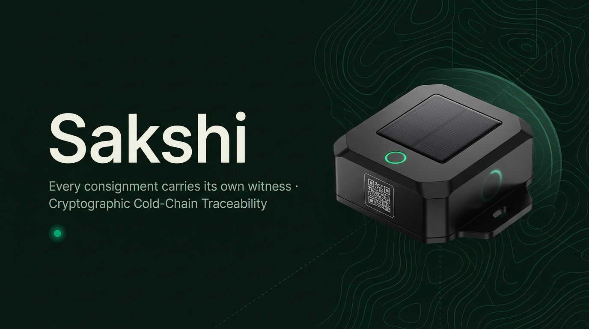
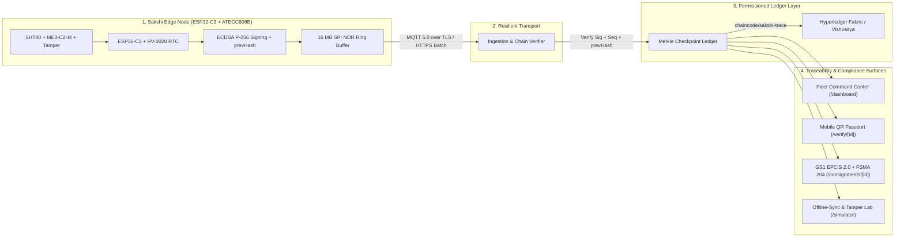

<p align="center">
  
</p>

<h1 align="center">Sakshi — Offline-First Cold-Chain Traceability</h1>

<p align="center">
  <strong>Every consignment carries its own witness.</strong><br />
  Hardware-rooted <code>ECDSA P-256</code> telemetry signing, zero-loss cellular blackout buffering, and standards-compliant <strong>GS1 EPCIS 2.0</strong> &amp; <strong>FDA FSMA 204</strong> traceability for agricultural exports.
</p>

<p align="center">
  
  
  
  
  
</p>

---

## Why Sakshi?

A blockchain only guarantees that records were not altered **after** reaching the server—it cannot prove that sensor logs weren't forged, dropped, or silently edited during rural cellular blackouts.

**Sakshi closes the physical-to-digital trust gap at the edge:**

1. **Sense & Compensate** — Tracks temperature (`Sensirion SHT40`, ±0.2°C), humidity (±1.8% RH), and ethylene ripening gas (`Winsen ME3-C2H4` on a continuous `<1 µA` transimpedance front-end with live temperature compensation).
2. **Sign at the Sensor** — Every sample is serialized canonically, linked to `prevHash` (`SHA-256`), stamped with a monotonic counter, and signed with **`ECDSA P-256` (`secp256r1`)** inside a `Microchip ATECC608B` secure element before leaving the device.
3. **Survive Cellular Blackouts** — When LTE drops on rural highway corridors, signed frames queue sequentially in a **16 MB SPI NOR ring buffer** and auto-sync in order upon reconnection.
4. **Verify Anywhere Without Trusting the Server** — Any importer, inspector, or consumer scanning a consignment QR code verifies the entire `ECDSA P-256` hash-chain directly inside their mobile browser using standard WebCrypto (`crypto.subtle.verify`).
5. **Sub-Zero Energy Harvesting** — `TI BQ25570` MPPT solar harvesting paired with a **Lithium Titanate (LTO)** buffer avoids lithium plating when charging below `0°C` in refrigerated transit.

---

## System Architecture



---

## Web Platform Surfaces

| Route | Purpose | Highlights |
| :--- | :--- | :--- |
| **`/`** | Product Overview | Live `#SAK-001` signed witness panel, hardware anatomy showcase, and standards overview |
| **`/dashboard`** | Fleet Command Center | Real-time thermal, humidity, ethylene (ppm), solar/LTO power, and cryptographic integrity status |
| **`/consignments/[id]`** | Proof & Compliance Inspector | Shaded offline-dropout telemetry charts, in-browser WebCrypto verifier, live **GS1 EPCIS 2.0 JSON-LD** preview, and CSV/JSON-LD downloads |
| **`/verify/[id]`** | Mobile QR Passport | Zero-trust client-side signature verification and farm-to-fork custody timeline on mobile |
| **`/simulator`** | Interactive Hardware & Tamper Lab | Simulate cellular blackouts, buffer ECDSA-signed frames offline, auto-sync batches, and trigger a live database tamper attack caught by the verifier |
| **`/research`** | Engineering & BOM Archive | Interactive solar/LTO power budget model, Qty 1 vs. Qty 100 unit economics, and ESP32-C3 pinout map |

---

## Repository Structure

```text
.
├── public/
│   └── sakshi-banner.jpg                  # Product hero & repository banner
├── src/
│   ├── app/
│   │   ├── page.tsx                       # Flagship landing & live witness card
│   │   ├── dashboard/page.tsx             # Fleet cold-chain command center
│   │   ├── consignments/[id]/page.tsx     # Proof inspector & EPCIS/FSMA exports
│   │   ├── verify/[id]/page.tsx           # Mobile-first QR verification passport
│   │   ├── simulator/page.tsx             # Interactive offline-sync & tamper lab
│   │   ├── research/page.tsx              # Power budget calculator & BOM archive
│   │   └── api/                           # Batch ingestion, export & tamper APIs
│   ├── components/                        # Telemetry charts, QR passport & lab UI
│   └── lib/
│       ├── crypto.ts                      # WebCrypto ECDSA P-256, SHA-256 & Merkle engine
│       ├── epcis.ts                       # GS1 EPCIS 2.0 JSON-LD & FDA FSMA 204 CSV
│       └── ledger.ts                      # Verifiable ledger store & realistic seed lots
├── firmware/
│   └── sakshi-hub/                        # ESP32-C3 PlatformIO firmware & pinout header
└── chaincode/
    └── sakshi-trace/                      # Hyperledger Fabric TypeScript smart contract
```

---

## Quickstart

### Prerequisites
- Node.js `20+` (verified on `v24.14.0`) and `npm`

### 1. Run Locally
```bash
git clone https://github.com/himanshu-2l/Sakshi-.git
cd Sakshi-
npm install
npm test          # Run ECDSA P-256, EPCIS 2.0, FSMA 204, and ledger integration tests
npm run typecheck # Strict TypeScript verification
npm run build     # Production Next.js build
npm run start     # Launch at http://localhost:3000
```

### 2. Try the Tamper-Detection & Offline-Sync Flow
1. Open **`/simulator`** in your browser.
2. Click **Kill Cellular Network** and capture 2–3 frames (`Sign & Buffer Frame Offline`).
3. Click **Reconnect LTE & Auto-Sync** to flush the queued batch and anchor a new Merkle checkpoint.
4. Click **Simulate Database Tamper Attack** to alter a stored temperature in the database without the device private key—the verifier immediately flags `HASH_MISMATCH` and `INVALID_SIGNATURE` at the exact corrupted sequence number.

### 3. Deploy to Vercel
The web platform runs zero-config with no mandatory external database keys. Connect the repository in **Vercel** (`Next.js` preset) and deploy directly—every route, API endpoint, and WebCrypto verifier works out of the box.

---

## API Reference

| Method & Path | Description |
| :--- | :--- |
| `GET /api/consignments` | List active consignments, latest telemetry, and verification summaries |
| `GET /api/consignments/[id]` | Full consignment bundle, custody events, signed frames, and Merkle anchors |
| `GET /api/consignments/[id]/export?format=epcis\|fsma` | Download **GS1 EPCIS 2.0 JSON-LD** or **FDA FSMA 204 CSV** |
| `POST /api/ingest/batch` | Validate `ECDSA P-256` signatures, `prevHash` links, and monotonic `seq` for live or offline-buffered batches |
| `POST /api/simulator/tamper` | Controlled demo mutation to test cryptographic tamper detection |
| `POST /api/simulator/reset` | Restore all seeded consignments to a clean verified baseline |

---

## Standards & Compliance Alignment

- **GS1 EPCIS 2.0 (`JSON-LD`)** — `ObjectEvent` + `sensorElementList` encoding `Temperature` (`CEL`), `Humidity` (`P1`), and `EthyleneConcentration` (`PPM`).
- **FDA FSMA Section 204** — Exportable Traceability Lot Code (`TLC`), Critical Tracking Events (`CTEs`), and Key Data Elements (`KDEs`).
- **EU Regulation (EC) 178/2002** — One-step-back / one-step-forward custodial provenance.
- **Permissioned Enterprise Ledgers** — Includes `SakshiTraceContract` (`chaincode/sakshi-trace`) for Hyperledger Fabric / National Blockchain Framework deployments.

---

<p align="center">
  Built with precision cryptography and clean engineering for transparent, low-waste agricultural cold chains.
</p>
